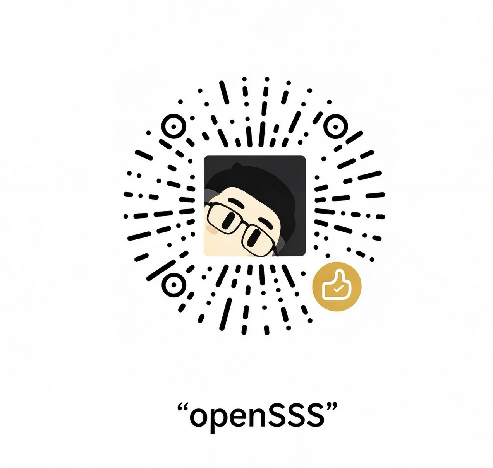

<div align="center">

# 📱 openSSS

### 中文优先的 iOS 侧载工具 —— 手机端签名，自己续签，把签名权从电脑抢回手机。

**不用电脑常驻，不用交月费，一部 iPhone + 一个免费 Apple ID 就够了。**

> 侧载这题，咱就是版本答案。🃏

[](https://github.com/SheldonJoO/openSSS/releases/latest)
[](LICENSE)
[](#)

**[⬇️ 下载安装 IPA](https://github.com/SheldonJoO/openSSS/releases/latest)** · **[🐦 关注 X @SheldonJo_O](https://x.com/SheldonJo_O)** · **[💬 反馈 Issue](https://github.com/SheldonJoO/openSSS/issues)**

</div>

---

## 🔥 为什么是版本答案

市面上大多数「手机签名」方案，要么要电脑挂着，要么要付费买证书，要么是套壳装上英文界面。

openSSS 全都不用：

- **签名在手机上完成** —— 免费 Apple ID 就能签，7 天到期后台自己续，不掉签、不用连电脑
- **中文是一等公民** —— `zh-Hans` 是开发语言，不是英文之上的翻译补丁
- **血统够硬** —— SideStore + AltStore 全套开源代码打底，Anisette / minimuxer / JIT 一个不少

名字取自四家：**AltStore + SideStore + iloader + Seal**。代码全部来自开源仓库；Seal 本身闭源，本项目不碰它的二进制、不抄它任何东西，只是做到了它那个效果——中文界面 + 手机端签名。

## ✨ 功能

| 功能 | 说明 |
|---|---|
| 📲 **手机端签名** | 个人 Apple ID（免费证书）直接在手机上签名安装 IPA，不用电脑常驻 |
| 🔄 **后台自动续签** | 7 天证书到期前自动刷新，不掉签 |
| 🌐 **Anisette 服务器管理** | 服务器可选择、拖动排序、隐藏；支持自定义目录 URL、导入自己的 JSON；自动轮换 |
| ⚡ **JIT** | 经 SideJIT 服务器为应用启用 JIT（上游注释称 iOS 17+ 新 JIT 实现在 SideStore 有已知问题） |
| 🎨 **自定义应用图标** | 为已安装应用更换图标（上游 AltAppIcons） |
| 📦 **应用源与更新** | 添加源、浏览、安装、更新一条龙 |
| 🇨🇳 **中文优先** | 界面第一语言就是中文（`CFBundleDevelopmentRegion = zh-Hans`），不是翻译包 |

## 📦 安装（首次）

1. 装官方版 [iloader](https://github.com/nab138/iloader)（手机连电脑，登录 Apple ID）
2. 选择「导入任意 IPA」，装入 [openSSS 最新 IPA](https://github.com/SheldonJoO/openSSS/releases/latest)
3. 用 iloader 导出配对文件（pairing file），通过 openSSS 自身的文件导入放进去

> ⚠️ 配对文件是手机端签名 / 续签的前提。官方版 iloader 的「导入 IPA」只装应用、不放配对文件——少了它，openSSS 装上也无法自己续签。
>
> 正在做基于 iloader v2.4.2 的小幅 fork（改名换图标、默认指向 openSSS release、配对文件表加入 openSSS），实现一键安装 + 自动放配对文件。在此之前按上面三步手动验证链路。

## 🔨 从源码构建

要求：macOS + Xcode 15+，Rustup。

```sh
git clone --recurse-submodules https://github.com/SheldonJoO/openSSS.git
cd openSSS
cp CodeSigning.xcconfig.sample CodeSigning.xcconfig
# 填入你的 DEVELOPMENT_TEAM
open AltStore.xcodeproj
```

命令行打包 IPA：

```sh
make build fakesign ipa
```

> 首次真机使用前需把配对文件放进应用（见上文「安装」），否则无法在手机上签名 / 续签。

### 中文优先是怎么做到的

- `CFBundleDevelopmentRegion` 为 `zh-Hans`，中文是 base 语言，不是备选本地化
- `Localizable.strings` 与各 storyboard 的 `.strings` 全部中文
- 出包验收：检查 IPA 内 `zh-Hans.lproj`、真机界面无英文回退

上次汉化尝试（SideStore-zh-Hans）踩过「翻译文件都在、App 却显示英文」的坑，本项目把本地化接线和出包验收写进流程，不再重犯。

## 🧬 开源血缘与许可证

| 来源 | 作用 | 许可证 |
|---|---|---|
| [SideStore](https://github.com/SideStore/SideStore) | 代码基底：手机端签名、Anisette、minimuxer、JIT、全部界面 | AGPLv3 |
| [AltStore](https://github.com/rileytestut/AltStore) | 上游原版：应用模型、应用源、AltSign 签名框架 | AGPLv3 |
| [iloader](https://github.com/nab138/iloader) | 桌面端 USB 安装器；官方版用于首次安装，计划小幅 fork | MIT（品牌另有 LICENSE-BRANDING 约束） |

本项目以 **AGPLv3** 发布。SideStore 与 AltStore 的 LICENSE、版权头、署名全部保留，修改处按 AGPLv3 要求标注。

Fork 点：SideStore `4f3d18d98c5fbee72c80f787ceb2e8e09ded60a6`；子模块 SideSign `752d1ef6`、minimuxer `12be70dc`，已转为普通目录随仓库携带。

## 🤝 参与

欢迎提 Issue / PR。

注意：如果要贡献回上游 SideStore，请先读上游的 `AGENTS.md`——上游对 AI 生成内容的贡献有严格限制，与维护者的沟通必须是人类对人类。

## 🙏 致谢

站在这些人的肩膀上：

- **Riley Testut** —— AltStore 原作者，整个 iOS 侧载生态的起点
- **SideStore 全体贡献者** —— 手机端签名与 Anisette 的地基
- **nab138** —— iloader，让首次安装变得简单
- **jkcoxson** —— minimuxer / em_proxy / idevice
- **Seal** —— 灵感来源（闭源，未使用其任何代码或二进制）

## ☕ 请作者喝杯咖啡

如果这玩意儿省了你折腾的功夫，欢迎点个饭 —— 你的支持是我继续维护更新的燃料 🍚

<div align="center">
  
</div>

## 📢 关注我，别错过下一版

新版本、踩坑记录、其他折腾项目都发在这儿，求波关注 👇

- **X / Twitter** [@SheldonJo_O](https://x.com/SheldonJo_O) —— 新版本首发、踩坑记录
- **GitHub** [SheldonJoO](https://github.com/SheldonJoO) —— 顺手点个 Star ⭐

---

<div align="center">
  <sub>Made with ☕ and 折腾 · openSSS · AGPLv3</sub>
</div>
